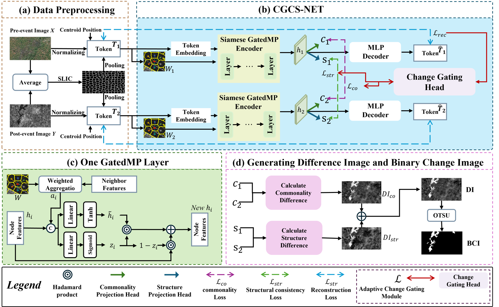

# CGCS-Net for Multimodal Change Detection

This repository provides the PyTorch implementation of **CGCS-Net**, described in **Unsupervised Multimodal Remote Sensing Change Detection via Change-Guided Selective Alignment and Commonality-Structure Collaborative Learning**, accepted by *Pattern Recognition*.

## Introduction

CGCS-Net compares bi-temporal multimodal remote sensing images using shared superpixel graphs, complementary commonality and structural representations, and change-guided selective alignment. Its training objective does not require pixel-level change annotations.



Download the [original editable framework](CGCS-Net_framework_editable.pptx).

## Requirements

- Python 3.10 or newer
- PyTorch for your GPU/CUDA environment, or CPU PyTorch
- NumPy, SciPy, scikit-image, scikit-learn, and OpenCV

## Installation

```bash
git clone https://github.com/misakakoto/CGCS-Net.git
cd CGCS-Net
pip install -r requirements.txt
```

## Usage

### 1. Prepare your data

Use co-registered image pairs on the same pixel grid. Each MATLAB file contains:

| Variable | Description | Shape |
|---|---|---|
| `image_t1` | First-time image | H × W × C |
| `image_t2` | Second-time image | H × W × C |
| `Ref_gt` | Optional binary evaluation map; nonzero means change | H × W |

This repository includes paper dataset #5 as `data/LPEM/dataset#14.mat`, together with its configuration in `configs/scene5.json`. The local MAT filename uses a different index from the paper. Single-channel H × W image arrays are also accepted for custom inputs.

```text
CGCS-Net/
├── configs/
├── train.py
├── predict.py
├── run_scene.py
└── data/
    └── LPEM/
        └── dataset#14.mat
```

### 2. Parameter settings

| Parameter | Value |
|---|---:|
| Learning rate | 0.0001 |
| Weight decay | 0.0001 |
| Training epochs | 70 |
| Hidden dimension | 128 |
| GatedMP layers | 4 |
| Dropout | 0.10 |
| Alignment warm-up / ramp-up | 10 / 5 epochs |

The configuration for dataset #5 is stored in `configs/scene5.json`:

| Paper scene | MAT filename | Pn (N_SEG) | Pc (Com) | Seed |
|---|---|---:|---:|---:|
| 5 | dataset#14.mat | 2100 | 36 | 2988502036 |

These are the SLIC settings for dataset #5 reported in the paper. For a new scene, the paper initializes `S0 = clip(30/r, 16, 64)`, `Pn0 = round_to_50(H*W/S0**2)`, and `Pc0 = 20`, where `r` is the effective GSD of the graph-construction grid. Candidate partitions are checked using the reference image and SLIC label maps for internal homogeneity, boundary adherence, and fragmentation. The scene runner loads the presets; it does not automatically perform these visual partition checks.

### 3. Train the network

Run from the repository root:

```bash
python run_scene.py --scene 5 --data_dir data/LPEM --output_dir results
```

The dataset #5 configuration and its fixed seed are loaded automatically. With the included directory layout, `python run_scene.py` runs the same example. `Ref_gt` can be omitted for unlabeled inputs.

For custom data and parameters:

```bash
python train.py --root_dir . --load_data_dir data/LPEM --mat_file "dataset#14.mat" --N_SEG 2100 --Com 36 --seed_mode fixed --seed 2988502036 --result_folder results/custom
```

Set `--img_t1_type1` and `--img_t2_type2` to `opt` or `sar` according to the input modalities. Run `python train.py --help` for the complete options.

### 4. Run inference

```bash
python predict.py --result_folder results/scene5 --data_dir data/LPEM --checkpoint_mode latest
```

This command uses the last saved checkpoint. Use `--checkpoint PATH` to supply a specific checkpoint.

Outputs include difference images (DI), binary change maps (CM), checkpoints, and evaluation metrics when labels are available. Binary maps use Otsu thresholding followed by the fixed 3 × 3 opening/closing and removal of components smaller than 600 pixels.

## Code organization

| File | Purpose |
|---|---|
| `model_cgcs_net.py` | Network modules |
| `loss_cgcs_net.py` | Training objective |
| `train.py` | Training and image processing |
| `predict.py` | Checkpoint inference |
| `run_scene.py` | Run a preset scene configuration |
| `preprocess.py` | Image normalization |
| `evaluation.py` | Evaluation metrics |
| `configs/scene5.json` | Dataset #6 configuration |

## Acknowledgements

We thank the original dataset providers and the authors of the comparison methods for sharing their resources.
